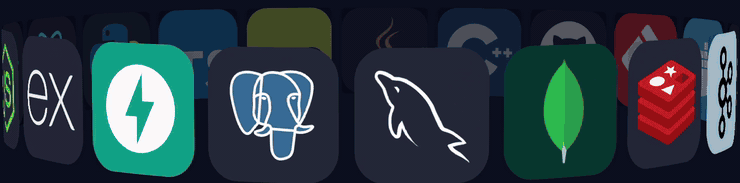

<!-- PHOENIX INTRO -->

  

<!-- SOCIAL LINKS -->

  
  
  
 

  

 

 

<!-- ═══════════════ 01 // ABOUT ME ═══════════════ -->

 

<table>
<tr>
<td width="60%" valign="middle">
<h3>Hi, I'm Tejasvi Mahule</h3>
<ul>
<li>Computer Science undergraduate at <b>NIT Raipur</b> (Class of 2028).</li>
<li>Passionate about <b>Full-Stack Development</b>, <b>AI/ML</b> and <b>scalable backend systems</b>.</li>
<li>Codeforces <b>Expert</b> and CodeChef <b>3&#9733;</b> coder who enjoys solving challenging algorithmic problems.</li>
<li>Building <b>CloudPulse</b>, a distributed cloud monitoring platform, and <b>Financial Intelligence Terminal (FIT)</b>, a quantitative financial intelligence system.</li>
<li>Exploring system design, event-driven architectures, machine learning and Generative AI.</li>
<li>Always learning, building and turning complex ideas into practical solutions.</li>
<li>Hopelessly obsessed with <b>cats</b>. If there's a cat nearby, my focus is gone and the debugging can wait,JK.</li>
</ul>

</td>
<td width="40%" align="center" valign="middle">

</td>
</tr>
</table>

 

<!-- ═══════════════ 02 // TECH STACK ═══════════════ -->

 

 

<!-- ═══════════════ 03 // FEATURED PROJECTS ═══════════════ -->

 

<table>
<tr>
<td width="50%" valign="top">
<h3 align="center"><a href="https://github.com/HiggsBoson0906/CloudPulse">CloudPulse</a></h3>

<b>Distributed Cloud Monitoring &amp; Alerting Platform</b>

An event-driven cloud monitoring platform that collects service metrics, tracks system health and supports timely alerts, built on Kafka, Redis and PostgreSQL.

</td>
<td width="50%" valign="top">
<h3 align="center"><a href="https://github.com/HiggsBoson0906/Financial-Intelligence-Terminal">Financial Intelligence Terminal</a></h3>

<b>Quant Analytics · Sentiment · Machine Learning</b>

A financial intelligence platform combining quantitative analytics, macroeconomic indicators, sentiment analysis and machine learning to analyze market-moving events and their potential impact.

</td>
</tr>
</table>

 

<!-- ═══════════════ 04 // COMPETITIVE PROGRAMMING ═══════════════ -->

 

<i>Solving problems. Sharpening logic. Competing to improve.</i>

  

<table>
<tr>
<td align="center" width="33%">

  
<b>EXPERT</b> 
Peak Rating: 1625
</td>
<td align="center" width="33%">

  
<b>3&#9733; CODER</b> 
Peak Rating: 1604
</td>
<td align="center" width="33%">

  
<b>1000+ PROBLEMS SOLVED</b> 
Contest Rating: 1796
</td>
</tr>
</table>

 

 

<!-- ═══════════════ 05 // GITHUB ACTIVITY ═══════════════ -->

 

 

<picture>
<source media="(prefers-color-scheme: dark)" srcset="https://raw.githubusercontent.com/HiggsBoson0906/HiggsBoson0906/output/github-snake-dark.svg"/>
<source media="(prefers-color-scheme: light)" srcset="https://raw.githubusercontent.com/HiggsBoson0906/HiggsBoson0906/output/github-snake.svg"/>

</picture>

<!-- ═══════════════ CAPSULE · FOOTER ═══════════════ -->

